# SchemeSaathi - System Architecture & Data Flow

## Architectural Overview
SchemeSaathi employs a decoupled, privacy-preserving, hybrid architecture combining:
1. **Automated Ingestion & Normalization Pipeline:** Ingests official PDF catalogs, verified CSV/JSON records, and scrapes public portals into a unified schema (`schemes.jsonl`).
2. **Hybrid Knowledge Base (RAG):** Multi-stage chunking with BM25 inverted index and dense Gemini vector embeddings.
3. **Deterministic Python Rule Engine:** Evaluates welfare eligibility using strict Boolean rule trees, preventing LLM hallucinations.
4. **FastAPI Asynchronous Gateway:** High-performance REST backend handling rate limiting, CORS, multilingual prompt orchestration, and notice parsing.
5. **Accessible Vernacular Frontend:** Mobile-first, responsive interface with native Web Speech API (STT & TTS) and zero PII storage.

---

## Architecture Diagram (Mermaid)

```mermaid
flowchart TD
    subgraph DataIngestion ["Data Ingestion & Indexing Pipeline"]
        A["Scheme_Explainer_Datasets.pdf"] -->|URL Extraction| B["scripts/ingest_datasets.py"]
        C["schemes_dataset.csv / json"] -->|Curated Core Rules| B
        B -->|Normalized Schema| D["data/processed/schemes.jsonl"]
        D -->|Section Chunking| E["scripts/build_index.py"]
        E -->|Keyword Inverted Index| F["data/index/bm25_index.pkl"]
        E -->|Dense Embeddings| G["data/index/embeddings.npy"]
    end

    subgraph ClientLayer ["Client Presentation (Browser)"]
        H["Citizen (Text / Voice Input)"] -->|Web Speech STT / UI| I["static/index.html & app.js"]
        I -->|Language Switching: EN, HI, KN, TA| J["static/locales.js"]
        K["Notice Photo / PDF Upload"] --> I
    end

    subgraph APILayer ["FastAPI Backend (app/main.py)"]
        I -->|POST /api/chat| L["RAG Engine (app/rag.py)"]
        I -->|POST /api/eligibility| M["Rule Engine (app/eligibility.py)"]
        I -->|POST /api/explain-notice| N["Notice Parser (app/notice.py)"]
        
        L -->|Retrieve Chunks| F
        L -->|Dense Similarity| G
        L -->|Prompt + Context| O["Gemini 2.5 / 1.5 Flash"]
        O -->|Grade-6 Vernacular Response| L
        L -->|Answer + Official Citations| I

        M -->|100% Deterministic Evaluation| P["Curated Rules Database"]
        P -->|Eligible / Ineligible / Missing Info| M
        M -->|Breakdown + Docs + Official Links| I

        N -->|Multimodal Vision & Extraction| O
        N -->|Summary + Deadlines + Disclaimer| I
    end

    subgraph OutputLayer ["Citizen Deliverables"]
        I -->|Web Speech TTS Synthesis| Q["Spoken Answer in Mother Tongue"]
        I -->|Color-Coded Badges| R["Eligible (Green) / Needs Info (Amber) / Ineligible (Red)"]
        I -->|Direct Navigation| S["Official Government Portal (pmkisan.gov.in, sevasindhu.karnataka.gov.in)"]
    end
```

---

## Detailed Component Breakdown

### 1. Ingestion & Pre-Processing (`scripts/ingest_datasets.py`)
- Extracts clickable URI annotations and regex URLs from `Scheme_Explainer_Datasets.pdf`.
- Classifies URLs into `huggingface`, `official_site`, `github`, or `ignore`.
- Skips large audio/model weights (BPCC, IndicVoices, Sangraha) in favor of lightweight browser speech APIs.
- Normalizes all records into `data/processed/schemes.jsonl` with strict merge precedence given to curated data.

### 2. Retrieval-Augmented Generation (`app/rag.py`)
- Scheme records are split by section: Benefits, Eligibility, Exclusions, Documents, Application Procedure, and Official Overview.
- BM25 indexing guarantees instant 100% offline retrieval without API keys or internet access.
- When `GEMINI_API_KEY` is present, queries are enriched with Gemini generative models prompting for Grade-6 simple sentences in English, Hindi, Kannada, or Tamil.

### 3. Deterministic Eligibility Engine (`app/eligibility.py`)
- Independent Python evaluator for all 13 schemes.
- Audits specific conditions: land ownership, income ceilings, age brackets, social category, pucca house ownership, and state residence.
- Returns explicit reasons for passing/failing each rule and compiles the exact checklist of physical documents required.

### 4. Multimodal Notice Explainer (`app/notice.py`)
- Accepts PDF or image formats from mobile cameras or scans.
- Isolates issuing departments, deadlines, and action points.
- Automatically appends a prominent legal disclaimer advising in-person verification with local Gram Panchayat officers.
